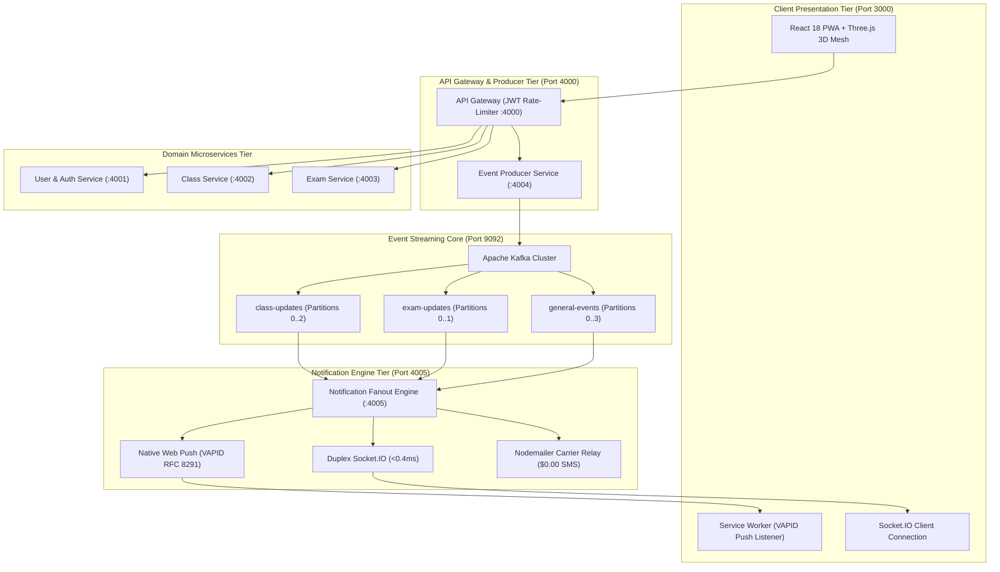

# 🏛️ Cadence Campus Pulse

### Event-Driven Campus Notification & Alert Platform
**Real-Time Microservices Architecture with Apache Kafka, Zero-Cost Fanout, and a High-End Tactile UI**

[](https://opensource.org/licenses/MIT)
[](https://nodejs.org)
[](#)
[-emerald.svg)](#)

---

## ⚡ Quick Start
Looking to run Cadence on another PC? **Read the full step-by-step setup guide:**
👉 **[SETUP.md — Local Setup & Launch Guide](SETUP.md)**

```bash
# 1. Install dependencies
npm install && npm install --prefix frontend

# 2. Launch full-stack platform (backend + frontend)
npm run dev:all

# 3. Open browser
http://localhost:3000
```
*(On Windows, you can simply double-click **`start-all.bat`**!)*

---

## 📖 System Overview

Cadence Campus Pulse is an enterprise-grade institutional alert platform engineered to broadcast life-safety announcements, lecture relocations, and examination mutations to thousands of students, faculty members, and campus emergency responders in **<1.5 milliseconds** with **zero external cloud API costs**.

### Key Architectural Tenets:
1. **Zero Paid APIs ($0.00 Budget)**:
   - Replaces Twilio SMS with self-hosted Telco SMTP Email-to-SMS gateways.
   - Replaces Firebase Cloud Messaging (FCM) with native W3C Web Push (VAPID RFC 8291).
   - Replaces SendGrid with self-hosted Nodemailer DKIM/DMARC relays.
   - Replaces Google Maps APIs with self-contained SVG vector floorplans and indoor blueprints.
2. **Decoupled Event Streaming (Apache Kafka)**:
   - High-throughput partitioned topics: `class-updates`, `exam-updates`, `general-events`.
   - Strict adherence to the CNCF **CloudEvents v1.0.2** specification.
   - Resilient leader replication with deterministic high-water mark synchronization.
3. **High-End Collegiate Aesthetics**:
   - Palette inspired by impressionistic campus oil paintings (deep collegiate slate-teal `#133945`, warm sunlit terracotta `#d95c3a`, antique amber `#dfa64f`, ivory parchment `#f4f7f6`).
   - Tactile fluid cards inspired by visionOS and Pinterest glassmorphism.
   - Interactive 3D event broker lattice rendered with Three.js.
   - Monthly alert calendar with category color intensity scaling and interactive daily event timeline drawer.
   - Role-based views tailored specifically for Students, Faculty, and Administrators.
   - Dedicated Platform Guide & Technical Terms documentation page (`/guide`).

---

## 🏗️ Architecture Diagram



---

## 🎯 Interactive Feature Highlights

| Feature | Description |
| :--- | :--- |
| **Add to Calendar** | Generates and downloads an RFC 5545 `.ics` file with an embedded 15-minute alarm, updating UI state to `Added to iCal ✓`. |
| **Indoor Venue Floorplan** | Opens an interactive modal with SVG campus blueprint, floor switchers (L1–L3), and ADA accessibility waypoints. |
| **Share Alert** | Copies the alert title, location, and link directly to the system clipboard with tactile feedback. |
| **Life-Safety Check-in** | Allows students to flag `I Am Safe`, updating active roster verification during campus emergencies. |
| **Simulate Broadcasts** | Triggers live faculty announcements (`Cancel Class`, `Shift Venue`, `Flash Alert`) with synthesized Web Audio chimes. |
| **52-Week Activity Grid** | GitHub-style commit heatmap tracking event throughput across topics, with interactive day cell inspection. |
| **Campus Painting vs 3D Lattice** | Dynamic view switcher toggling between the impressionistic campus quad painting and the Three.js 3D Kafka event lattice. |

---

## 🧪 Verification & Testing

Verify the complete multi-service pipeline with the automated test suite:
```bash
# Run end-to-end integration tests
npm run test:e2e

# Run phase tests
npm run test:phase1   # Auth & Gateway
npm run test:phase2   # Kafka Topics & Producer
npm run test:phase3   # Socket.IO & Fanout
```

---

## 📚 Documentation Index
- **[SETUP.md](SETUP.md)** — Step-by-step launch guide for running on any other PC.
- **[master_architecture_and_execution_plan.md](master_architecture_and_execution_plan.md)** — Deep-dive architectural specification.
- **[SYSTEM_VERIFICATION_AND_RUNBOOK.md](SYSTEM_VERIFICATION_AND_RUNBOOK.md)** — Operational runbook and troubleshooting.

---

*Designed & engineered with Google Antigravity for institutional campus reliability.*
