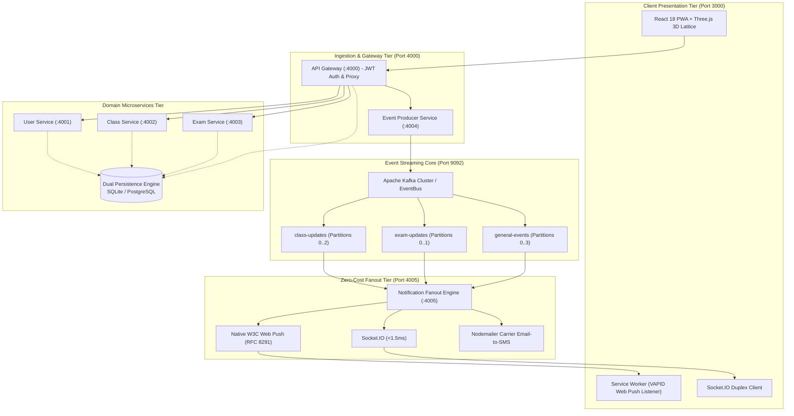

# 🏛️ Cadence Campus Pulse

### Event-Driven Institutional Notification & Alert Platform
> **High-Throughput Microservices Architecture with Apache Kafka, Zero-Cost Multi-Channel Fanout, Embedded ACID Database, and a Tactile Collegiate PWA**

[](https://opensource.org/licenses/MIT)
[](https://nodejs.org)
[](https://react.dev)
[](https://vitejs.dev)
[](https://threejs.org)
[](https://kafka.apache.org)
[%20%2B%20PostgreSQL-336791.svg)](#-database-architecture)
[-emerald.svg)](#-zero-cost-multi-channel-fanout)

---

> [!TIP]
> **Recommended GitHub Repository Description & Topics:**
> - **About Description:** `Event-Driven Campus Notification & Alert Platform with Apache Kafka, Node.js Microservices, Zero-Cost Multi-Channel Fanout ($0 Twilio/FCM), Dual Embedded SQLite/PostgreSQL, and Tactile React PWA.`
> - **Topics/Tags:** `microservices`, `kafka`, `event-driven-architecture`, `react`, `threejs`, `sqlite`, `postgresql`, `socketio`, `webpush`, `campus-safety`, `vite`, `zero-cost`

---

## ⚡ 60-Second Quick Start

No Docker or external database required! The application includes an embedded SQLite engine and in-memory event bus fallback that runs immediately on any Windows, macOS, or Linux machine.

### Option 1: One-Click Quick Launch
- **Windows:** Double-click **`start-all.bat`** (or run `.\start-all.bat` in Command Prompt / PowerShell).
- **macOS / Linux:** Run `chmod +x start-all.sh && ./start-all.sh`.

### Option 2: Terminal Commands
```bash
# 1. Clone the repository
git clone https://github.com/JoshThomas06/CADENCE-CAMPUS-NOTIFICATION-.git
cd CADENCE-CAMPUS-NOTIFICATION-

# 2. Install all dependencies (backend + frontend)
npm run setup

# 3. Launch full-stack platform (API Gateway, 5 Microservices + Vite React)
npm run dev:all

# 4. Open your browser
# Frontend UI:   http://localhost:3000
# API Gateway:   http://localhost:4000
```

---

## 🔑 3-Portal Login & Demo Accounts

Cadence Campus Pulse implements **strict authentication gating**. Unauthenticated visitors can explore the Landing screen; entering any of the functional systems requires logging into one of the **3 distinct institutional portals**:

| Portal | Role | Sample Email | Password | Capabilities & Authority |
| :--- | :--- | :--- | :--- | :--- |
| 🎓 **Student Access Portal** | `Student` | `student@campus.edu` | `student123` | Read-only live alert stream, RFC 5545 `.ics` calendar export, SVG campus floorplans, "I Am Safe" emergency check-in, device notification preferences. |
| 👨‍🏫 **Faculty & Instructor Console** | `Faculty` | `faculty@campus.edu` | `faculty123` | Course-level alert creation, lecture relocation & cancellation mutations, **Live Database & CRUD Studio**, enrolled roster inspector. |
| 🏛️ **Senate Operations & Admin** | `Admin` | `admin@campus.edu` | `admin123` | **Full Platform Authority**: Emergency Flash sirens, Database CRUD & SQL query console, live Apache Kafka partition telemetry, consumer lag diagnostics, system dry-runs. |

> [!NOTE]
> **1-Click Test Login**: On the Sign In screen (`http://localhost:3000/auth`), click the tab for any role and hit **"1-Click Fill & Test Login"** to instantly sign in without typing!

---

## 🏗️ Architecture & Network Directory

The platform is designed around a decoupled, event-driven microservices architecture communicating via REST, Kafka event streams, and duplex WebSockets:



### Network Port Directory

| Service | Port | Protocol | Purpose |
| :--- | :--- | :--- | :--- |
| **Frontend PWA** | `:3000` | HTTP / WSS | Vite React application with Three.js 3D lattice |
| **API Gateway** | `:4000` | HTTP | Reverse proxy, JWT authentication & rate limiting |
| **User Service** | `:4001` | HTTP / REST | Student, faculty & admin identity directory |
| **Class Service** | `:4002` | HTTP / REST | Lecture schedules, classroom venues & cancellations |
| **Exam Service** | `:4003` | HTTP / REST | Midterm & final exam seating, auditoriums & schedules |
| **Event Producer** | `:4004` | HTTP / REST | CloudEvents v1.0.2 ingestion & topic dispatch |
| **Notification Engine**| `:4005` | WSS / VAPID | Duplex Socket.IO, VAPID Web Push & Nodemailer relay |
| **Apache Kafka** *(Opt.)*| `:9092` | TCP | Partitioned event broker (automatic fallback if offline) |
| **PostgreSQL** *(Opt.)* | `:5432` | TCP | Relational persistence (automatic fallback to embedded SQLite) |

---

## 🌟 Key Platform Features

### 1. 🗄️ Live Database & CRUD Studio (`/database`)
- **Integrated Table Explorer**: Inspect and manage `courses`, `users`, `exams`, and `alert_audit_ledger` in real-time.
- **Interactive Mutations**:
  - **Create**: Add new courses and users via validated modal dialogs.
  - **Read**: Live search, status filters (`NORMAL`, `RELOCATED`, `CANCELLED`), and millisecond query latency counters.
  - **Update**: 1-click status cycling or in-depth inline field editing.
  - **Delete**: Remove records with instant two-way synchronization.
- **SQL Console**: Execute custom raw SQL queries (`SELECT * FROM courses;`) or run pre-configured administrative diagnostic presets.
- **Zero-Dependency Persistence**: Backed by Node 22's native `node:sqlite` engine (`services/shared/data/campus_pulse.db`) with automatic bidirectional sync to PostgreSQL when connected.

### 2. 💸 Zero-Cost Multi-Channel Fanout ($0.00 SaaS Budget)
- **Eliminates Twilio SMS Fees**: Uses self-hosted Telco SMTP Email-to-SMS carrier gateways (Verizon `@vtext.com`, AT&T `@txt.att.net`, T-Mobile `@tmomail.net`, Sprint `@messaging.sprintpcs.com`, Google Fi `@msg.fi.google.com`, US Cellular `@email.uscc.net`).
- **Eliminates Firebase Cloud Messaging (FCM)**: Native W3C Web Push using VAPID keys (RFC 8291).
- **Eliminates SendGrid / Mailgun**: Self-hosted Nodemailer DKIM/DMARC relay with live Ethereal testing and 1-click custom Gmail SMTP binding.
- **Sub-1.5ms Duplex WebSockets**: Real-time Socket.IO room broadcast.

### 3. 📡 Deep Sender-to-Target Recipient Audit Trail
- Inside the **Event Dispatcher** (`/event-dispatcher`), the **Audit Trail** traces each broadcast from **Sender** (e.g. `Dr. Julian Vance (Faculty)`) &rarr; **Target Recipients** (e.g. `Maya Lin + 198 students`).
- Clicking **"Inspect"** reveals the cryptographic trajectory:
  - Provenance with Ed25519 digital signature.
  - Per-student recipient breakdown with carrier phone routing, institutional email delivery, and SHA-256 receipt hashes.
  - Direct 1-click link to locate the record inside the Database Studio.

### 4. 📅 Monthly Alert Calendar & Intensity Heatmap
- Clean Sunday–Saturday monthly calendar view with month and year navigation.
- **Category Color Coding**: Terracotta Rust for Classes, Amber Gold for Exams, Crimson for Campus Emergencies, and Slate-Teal for Combined general alerts.
- **4-Level Frequency Opacity**: Dynamically scales border and fill opacity based on daily event volume.
- **Daily Event Timeline Drawer**: Click any day cell to slide out its chronological event timeline with exact timestamps, course tags, and severity badges.

### 5. 🗺️ Zero-Cost Interactive Indoor Blueprints
- Replaces expensive Google Maps APIs with self-contained, high-performance SVG vector campus blueprints.
- Features multi-floor level switchers (L1–L3), active lecture halls, emergency egress corridors, and ADA accessibility waypoints.

### 6. 🎨 Aesthetic Fusion: Collegiate Impressionism & 3D WebGL
- Palette inspired by plein-air collegiate oil paintings (deep slate-teal `#133945`, warm terracotta `#d95c3a`, antique amber `#dfa64f`, ivory parchment `#f4f7f6`).
- Interactive Three.js 3D event broker lattice visualizing live message streaming.
- Synthesized Web Audio alert chimes (zero external audio file dependencies).

---

## 🧪 Verification & Testing Suite

Run the comprehensive automated test suite to verify all microservices, database transactions, Kafka streaming, and notification fanout:

```bash
# 1. Full End-to-End Pipeline Integration Test
npm run test:e2e

# 2. Database CRUD & SQL Query Console Test
npm run test:database

# 3. Microservice Phase Tests
npm run test:phase1    # Auth & API Gateway
npm run test:phase2    # Kafka Producers & Topics
npm run test:phase3    # Tri-Fanout (WebPush, Socket.IO, Nodemailer)

# 4. Frontend Production Build Check
npm run build:frontend
```

---

## 🛠️ Configuration & Optional Docker

### Environment Variables (`.env`)
The platform works out of the box with zero configuration! If you wish to customize ports, connect an external database, or bind your real email/SMS relay, copy `.env.example` to `.env`:

```bash
cp .env.example .env
```

| Variable | Default | Purpose |
| :--- | :--- | :--- |
| `DATABASE_URL` | *None (uses SQLite)* | PostgreSQL connection string |
| `KAFKA_BROKERS` | `localhost:9092` | Comma-separated Kafka broker addresses |
| `REAL_SMTP_USER` | *None (uses Ethereal)* | Gmail address for live outbound notifications |
| `REAL_SMTP_PASS` | *None* | 16-character Google App Password |

### Optional: Docker Deployment (Kafka + PostgreSQL)
If you have Docker Desktop installed and want true containerized Kafka and PostgreSQL:
```bash
# Start Kafka, Zookeeper, and PostgreSQL
docker compose up -d

# Start the Cadence platform
npm run dev:all

# Stop containers when finished
docker compose down
```

---

## 📂 Project Directory Structure

```text
fsd-project/
├── frontend/                     # React 18 + Vite + Tailwind + Three.js PWA
│   ├── src/
│   │   ├── components/           # UI components (HeaderNav, Footer, Modals, 3D Lattice)
│   │   ├── components/screens/   # 3 Portal screens (Landing, LiveStream, Dispatcher, Database, Telemetry, Guide)
│   │   ├── utils/                # RFC 5545 calendar generator & Web Audio synthesizer
│   │   └── App.tsx               # Root router & role-based authentication context
├── gateway/                      # Express API Gateway (:4000) & Reverse Proxy
├── services/
│   ├── user-service/             # Authentication & user directory (:4001)
│   ├── class-service/            # Course schedules & relocations (:4002)
│   ├── exam-service/             # Examination seating & schedules (:4003)
│   ├── event-service/            # Event ingestion & CloudEvents validation (:4004)
│   ├── notification-service/     # Socket.IO, VAPID Web Push & Nodemailer fanout (:4005)
│   └── shared/
│       ├── database-manager.js   # Dual SQLite / PostgreSQL persistence engine
│       ├── kafka-client.js       # Kafka producer/consumer with in-memory EventBus fallback
│       └── data/                 # SQLite database & JSON stores
├── scripts/
│   ├── start-all.js              # Backend services launcher
│   └── start-everything.js       # Full-stack orchestrator (backend + frontend)
├── tests/                        # Automated test suites (E2E, CRUD, Phases 1-3)
├── docker-compose.yml            # Optional container definitions (Kafka, Postgres)
├── start-all.bat                 # One-click Windows launcher
├── start-all.sh                  # One-click macOS / Linux launcher
├── package.json                  # Root npm dependencies and execution scripts
├── .env.example                  # Environment variable reference template
├── .gitignore                    # Git rules (excludes node_modules & build artifacts)
└── SETUP.md                      # Comprehensive local setup documentation
```

---

## 📄 License & Attribution

Distributed under the **MIT License**. Engineered for campus safety and institutional reliability.
