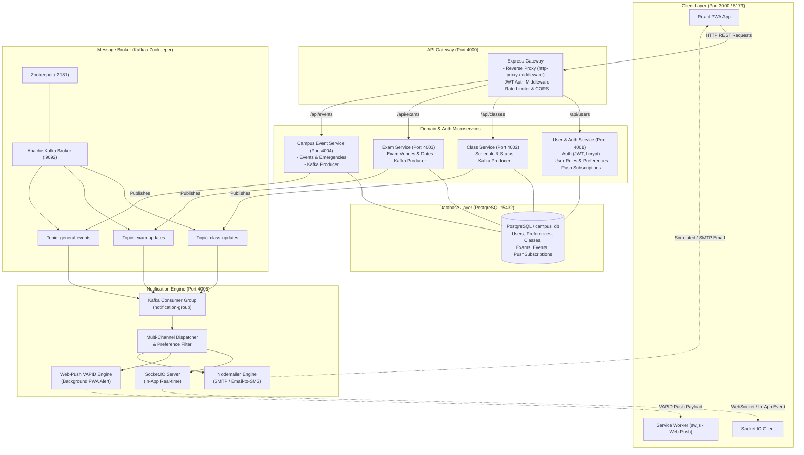
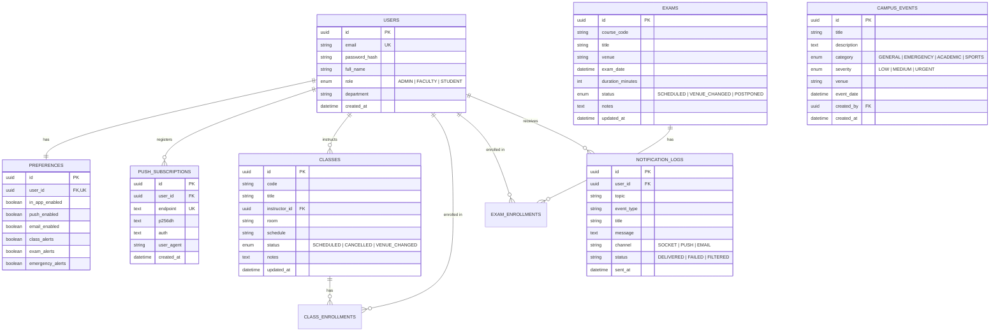
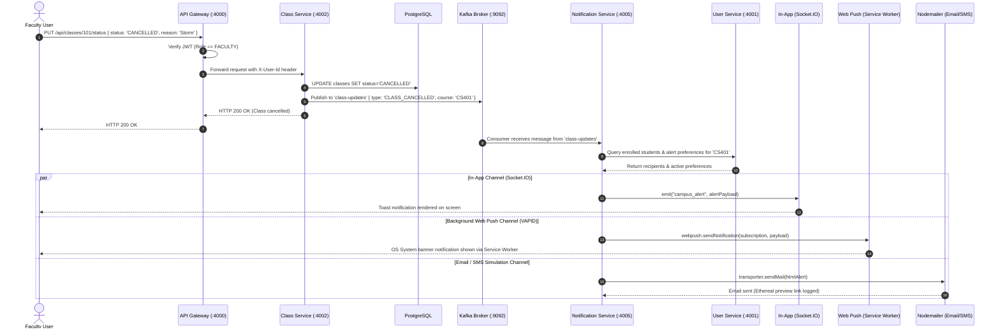

# Master Architecture & Execution Plan: Event-Driven Campus Notification Platform

## 1. Executive Summary & Core Invariants

The **Event-Driven Campus Notification & Alert Platform** is a decoupled, microservices-based, real-time alert distribution system engineered for university campuses. It broadcasts immediate updates for class cancellations, exam rescheduling, emergency alerts, and campus events.

### Core Architecture Invariants:
1. **Zero-Cost / Self-Hosted Requirement:** 
   - Strict prohibition against paid external APIs (Twilio, SendGrid, Firebase Cloud Messaging, AWS SNS).
   - In-app real-time alerts via **Socket.IO**.
   - Background push alerts via native **Web Push API (VAPID / RFC 8291/8292)**.
   - Email/SMS notifications via **Nodemailer** (Ethereal test accounts / standard SMTP / carrier Email-to-SMS).
2. **True Event-Driven Decoupling:** 
   - Domain microservices (Class, Exam, Event) never communicate synchronously with the Notification Service.
   - State mutations persist to the database first, then publish strongly-typed events to **Apache Kafka**.
   - The Notification Engine acts as a pure reactive consumer subscribing to Kafka topics.
3. **Multi-Tenant User Roles & Preferences:**
   - **Admin:** Full CRUD across campus schedules, broadcast emergency alerts, manage users.
   - **Faculty:** Manage assigned classes and exams; trigger cancellations and venue changes.
   - **Student:** Real-time stream of subscribed course updates and campus emergency broadcasts.
   - Granular delivery preference controls: in-app, web push, and email toggles per alert category.
4. **Resilient Local & Production Dual-Mode:**
   - Production / Docker mode: Confluent Kafka 7.3.0 + Zookeeper + PostgreSQL 15.
   - Development fallback mode: Built-in pluggable broker adapter (KafkaJS with automatic in-memory EventEmitter / local broker fallback) so services can run without Docker or with Docker seamlessly.

---

## 2. System Topology & Network Architecture



---

## 3. Database Schema Specification

We will configure PostgreSQL (with Prisma ORM for type safety and automatic migrations).



---

## 4. Kafka Event Message Contracts

All events adhere to a CloudEvents-inspired canonical JSON envelope:

### Standard Event Envelope Schema
```json
{
  "eventId": "evt_98f4e24a-89a1-42e3-b1d5-7835b6fa1311",
  "traceId": "trc_45b0a1ec",
  "topic": "class-updates",
  "eventType": "CLASS_CANCELLED",
  "timestamp": "2026-10-12T09:00:00.000Z",
  "producer": "class-service",
  "priority": "HIGH",
  "data": {
    "classId": "cls_101",
    "courseCode": "CS401",
    "courseTitle": "Distributed Systems",
    "instructorName": "Dr. Sarah Lin",
    "originalRoom": "Hall 3B",
    "newRoom": null,
    "scheduleTime": "Mon 10:00 AM",
    "reason": "Instructor unwell",
    "targetAudience": {
      "courseCode": "CS401",
      "roles": ["STUDENT", "FACULTY"]
    }
  },
  "metadata": {
    "triggeredBy": "usr_fac_22",
    "version": "1.0.0"
  }
}
```

### Topic Breakdown & Event Types

| Topic | Event Type | Priority | Trigger Action | Default Channels |
| :--- | :--- | :--- | :--- | :--- |
| `class-updates` | `CLASS_CANCELLED` | HIGH | Faculty cancels scheduled class | Socket + Web Push + Email |
| `class-updates` | `VENUE_CHANGED` | HIGH | Faculty moves classroom | Socket + Web Push |
| `exam-updates` | `EXAM_POSTPONED` | URGENT | Faculty/Admin reschedules exam | Socket + Web Push + Email |
| `exam-updates` | `VENUE_CHANGED` | HIGH | Exam hall reassignment | Socket + Web Push + Email |
| `general-events`| `CAMPUS_EMERGENCY` | CRITICAL | Admin issues weather/safety alert | Socket + Push + Email (Overrides opt-outs) |
| `general-events`| `NEW_EVENT` | NORMAL | New campus workshop or activity | Socket |

---

## 5. Microservices Architecture & API Surface

### 1. API Gateway (Port 4000)
- **Role:** Single unified entry point for all frontend requests, CORS policy enforcement, rate limiting, and JWT authentication verification.
- **Route Proxying:**
  - `/api/auth/*` & `/api/users/*` $\rightarrow$ User Service (`http://localhost:4001`)
  - `/api/classes/*` $\rightarrow$ Class Service (`http://localhost:4002`)
  - `/api/exams/*` $\rightarrow$ Exam Service (`http://localhost:4003`)
  - `/api/events/*` $\rightarrow$ Event Service (`http://localhost:4004`)
  - `/api/notifications/*` $\rightarrow$ Notification Service (`http://localhost:4005`)
- **JWT Middleware:** Verifies Bearer token, extracts `user: { id, email, role }`, and forwards identity via `X-User-Id` and `X-User-Role` upstream headers.

### 2. User & Auth Service (Port 4001)
- **Endpoints:**
  - `POST /api/auth/register`: Create user with email, password (hashed with bcrypt), name, role (`ADMIN`, `FACULTY`, `STUDENT`).
  - `POST /api/auth/login`: Authenticate and issue signed JWT (payload: `id`, `email`, `role`).
  - `GET /api/users/me`: Return current user profile, enrolled classes, preferences.
  - `PUT /api/users/preferences`: Update alert delivery preferences (email, push, in-app).
  - `POST /api/users/push-subscription`: Store/update browser `PushSubscription` (endpoint, keys: `p256dh`, `auth`).
  - `DELETE /api/users/push-subscription`: Revoke active push subscription.
  - `GET /api/users/recipients`: Internal lookup endpoint used by Notification Engine to resolve audience targeting and check active preferences.

### 3. Class Service (Port 4002)
- **Endpoints:**
  - `GET /api/classes`: List classes (filter by department, instructor, student enrollment).
  - `POST /api/classes`: Create class (Admin/Faculty).
  - `PUT /api/classes/:id/status`: Update status (`CANCELLED`, `ACTIVE`). Triggers Kafka publish to `class-updates`.
  - `PUT /api/classes/:id/venue`: Update classroom venue. Triggers Kafka publish to `class-updates`.

### 4. Exam Service (Port 4003)
- **Endpoints:**
  - `GET /api/exams`: List scheduled exams.
  - `POST /api/exams`: Create exam entry.
  - `PUT /api/exams/:id/venue`: Update exam hall/venue. Triggers Kafka publish to `exam-updates`.
  - `PUT /api/exams/:id/postpone`: Postpone exam date and time. Triggers Kafka publish to `exam-updates`.

### 5. Event Service (Port 4004)
- **Endpoints:**
  - `GET /api/events`: List campus events & past emergency alerts.
  - `POST /api/events`: Create standard campus event. Triggers Kafka publish to `general-events` (`NEW_EVENT`).
  - `POST /api/events/emergency`: Admin trigger for critical campus alert. Triggers Kafka publish to `general-events` (`CAMPUS_EMERGENCY`).

### 6. Notification Service & Real-Time Hub (Port 4005)
- **Role:** Pure event-driven reactive consumer + multi-channel dispatch hub.
- **Kafka Consumer:** Subscribes to consumer group `notification-group` across `class-updates`, `exam-updates`, and `general-events`.
- **In-App Real-time (Socket.IO):**
  - Clients connect with JWT handshake.
  - Sockets automatically join rooms: `user:<id>`, `role:<role>`, `course:<codecode>`, `broadcast:campus`.
  - When an event is received, message is pushed to corresponding socket rooms instantly.
- **Web Push Engine (`web-push`):**
  - Configured with VAPID keys (`publicKey`, `privateKey`, `subject: mailto:admin@campus.edu`).
  - Encrypts and transmits push payload to browser endpoints with actions (`[View Details]`, `[Dismiss]`).
- **Nodemailer Engine:**
  - Uses test SMTP account (`Ethereal Email`) generating live click-to-view preview URLs in console, or local SMTP transport.
  - Formats rich HTML alert emails with high-urgency banners.
- **REST Endpoints (Admin & History):**
  - `GET /api/notifications/history`: Retrieve recent notifications for current user.
  - `GET /api/notifications/vapid-public-key`: Returns the public VAPID key to the frontend PWA.

---

## 6. Multi-Channel Notification Flow & Pipeline



---

## 7. Phased Implementation Roadmap (PAUL Framework)

### Phase 1: Foundation, API Gateway & User Service
- **Step 1.1:** Setup project monorepo structure with workspace root scripts (`npm run start:all`, `npm run dev`).
- **Step 1.2:** Configure `docker-compose.yml` for PostgreSQL, Zookeeper, and Kafka. Provide seamless zero-Docker fallback mode for environments without Docker Desktop running.
- **Step 1.3:** Initialize **User Service** (port 4001):
  - Setup Prisma/PostgreSQL schema (`User`, `Preference`, `PushSubscription`).
  - Auth controllers: JWT signing, bcrypt password hashing, registration, login.
  - Endpoints to store Web Push subscriptions and preferences.
- **Step 1.4:** Initialize **API Gateway** (port 4000):
  - Setup `express`, `http-proxy-middleware`, `cors`, and JWT verification middleware.
  - Route `/api/auth` and `/api/users` to User Service.
  - Verify acceptance criteria (AC-1, AC-2, AC-3).

### Phase 2: Domain Services & Kafka Producers
- **Step 2.1:** Create unified Kafka client library / abstraction (`kafka-client.js`) with automatic fallback to local event bus if Kafka broker is unavailable.
- **Step 2.2:** Initialize **Class Service** (port 4002):
  - Model for classes & schedules.
  - Endpoints for class creation, status update (cancel), venue update.
  - Kafka producer emitting to `class-updates`.
- **Step 2.3:** Initialize **Exam Service** (port 4003):
  - Model for exam schedules and venues.
  - Endpoints for venue change and postponement.
  - Kafka producer emitting to `exam-updates`.
- **Step 2.4:** Initialize **Event Service** (port 4004):
  - Model for general events and emergency broadcasts.
  - Kafka producer emitting to `general-events`.
- **Step 2.5:** Update API Gateway to route `/api/classes`, `/api/exams`, `/api/events`. Verify AC-1, AC-2, AC-3.

### Phase 3: Notification Engine & Real-Time Consumer
- **Step 3.1:** Initialize **Notification Service** (port 4005).
- **Step 3.2:** Generate VAPID key pairs using `web-push generate-vapid-keys`.
- **Step 3.3:** Configure Kafka Consumer listening to topics `class-updates`, `exam-updates`, `general-events` on group `notification-group`.
- **Step 3.4:** Setup **Socket.IO** server with JWT auth and room management.
- **Step 3.5:** Setup **Web Push** dispatch logic using VAPID keys.
- **Step 3.6:** Setup **Nodemailer** with Ethereal test account and preview logging.
- **Step 3.7:** Test end-to-end event consumer: trigger a class cancellation in Class Service $\rightarrow$ observe instant Socket emit, push notification, and email log in Notification Service.

### Phase 4: React PWA Frontend (To be visually planned in the next step!)
- **Step 4.1:** React + Vite PWA scaffolding (`frontend` directory).
- **Step 4.2:** Service Worker (`sw.js`) implementation for push notification receipt (`self.addEventListener('push', ...)`).
- **Step 4.3:** Socket.IO client integration for real-time live alert toast banners.
- **Step 4.4:** Interactive UI Dashboards:
  - Role switcher (Admin, Faculty, Student).
  - Faculty/Admin action triggers (Cancel Class, Change Exam Hall, Emergency Broadcast).
  - Student real-time stream, notification center, and toggle preferences.

### Phase 5: Verification, Acceptance Testing & E2E Validation
- **Step 5.1:** Automated health check and integration test script.
- **Step 5.2:** Verify all Acceptance Criteria (AC-1 through AC-5 across all phases).
- **Step 5.3:** Document setup and running instructions in comprehensive runbook.

---

## 8. Development Environment & Execution Modes

| Component | Standard Production Mode | Zero-Docker / Local Dev Mode |
| :--- | :--- | :--- |
| **Database** | Docker PostgreSQL 15 (`localhost:5432`) | SQLite / local Postgres via Prisma |
| **Broker** | Confluent Kafka 7.3.0 (`localhost:9092`) | Built-in EventBus adapter / local Kafka |
| **Push** | Native Web Push VAPID API | Native Web Push VAPID API (100% free) |
| **Email** | Nodemailer with Ethereal / SMTP | Nodemailer with Ethereal / Console log |
| **In-App** | Socket.IO WebSockets | Socket.IO WebSockets |

This dual-mode architecture guarantees the system is 100% compliant with the course's microservices PRD while running friction-free on any development machine.
